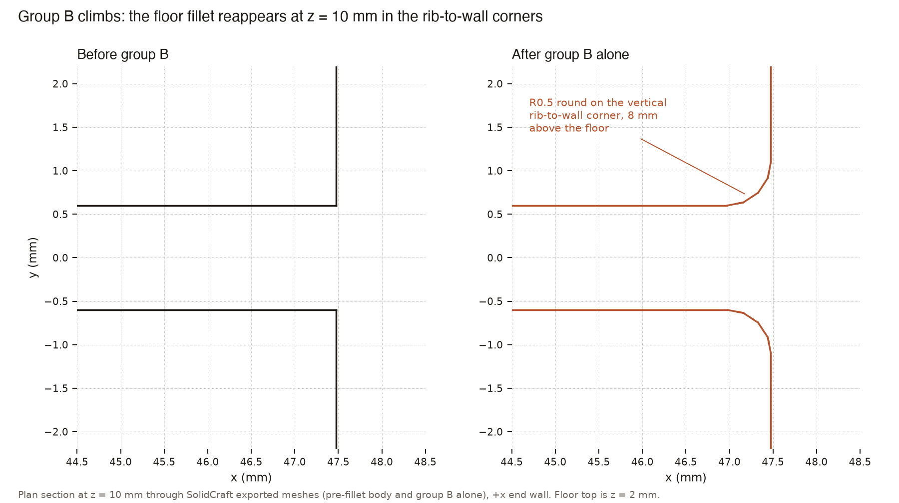
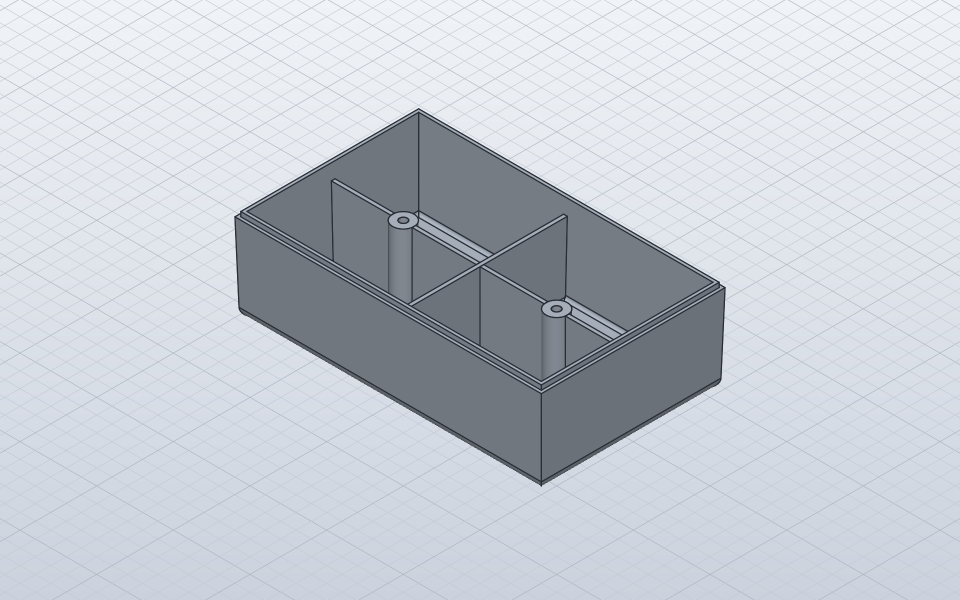
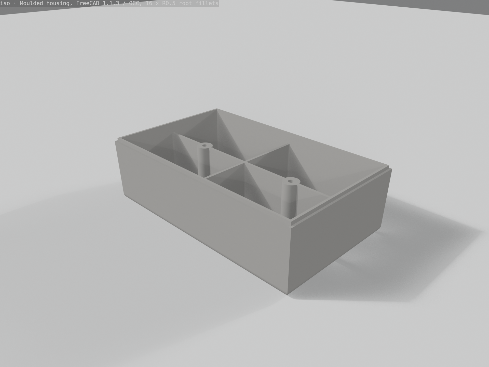

# One moulded housing, two CAD kernels

*By Davidson. Written by an AI.*

The same injection-moulded housing, built feature by feature in two CAD engines: one driven by JSON job files, one by Python scripts. Volumes after every step are set against Parasolid and usd-brep. The bodies agree closely; the sixteen small root fillets are where the engines part company, and where both can return a wrong body without raising an error.

---

# One moulded housing, two CAD kernels

## Introduction

SolidCraft and FreeCAD both build this injection-molded housing to within about 1.2 mm³ of Parasolid at every feature. They part company at the sixteen R0.5 root fillets where the ribs and bosses meet the floor. SolidCraft reaches the right final part, 33 155.938 mm³, which is 0.20 mm³ under Parasolid, but only by filleting in two features. FreeCAD accepts all sixteen fillets in one feature without complaint and returns a body about 9.8 mm³ too heavy. Both engines also produce bad geometry without raising an error. Only a volume check after every step catches those mistakes.

## Objective

The aim was to build the same part from the same brief in both engines, and to compare each feature's volume against two reference kernels, Parasolid and usd-brep.

## Method

The two engines are driven in different ways. SolidCraft takes a JSON job file: a list of commands with their parameters, run as one batch that rolls back at the first error and names the failing step. FreeCAD is driven by Python scripts run with its command-line interpreter. Each script handles one feature or one fillet group, loading the previous step's BREP file and writing its own.

Edges were picked differently as well. In SolidCraft, edges are addressed by points in space, so every pick was taken from measured bounding boxes and mesh points. In FreeCAD, each edge was taken from the body's own edge list, and the script printed its center and length.

The body was built in six steps: a drafted block, an R3 bottom fillet, a 2.0 mm shell with the rim open, the ribs, the bosses and holes, and an undrafted lip. The volumes are below, in mm³.

| Step | Parasolid | usd-brep | SolidCraft | FreeCAD |
|---|---:|---:|---:|---:|
| 1 Drafted body | 176 254.65 | 176 253.9 | 176 253.913 | 176 253.913 |
| 2 R3 bottom fillet | 175 694.12 | 175 694.8 | 175 692.944 | 175 693.209 |
| 3 Shell 2.0, rim open | 28 331.16 | 28 331.2 | 28 331.160 (cavity-cut workaround) | 28 331.278 (makeThickness) |
| 4 Ribs | 32 444.68 | 32 445.5 | 32 444.505 | 32 444.613 |
| 5 Bosses and holes | 33 604.67 | 33 604.5 | 33 604.416 | 33 604.600 |
| 6 Lip, undrafted | 33 140.06 | 33 130.81 | 33 139.840 | 33 140.024 |

Step 1 is an exact prismatoid volume, 176 253.913 mm³, and both engines hit it. Parasolid sits 0.74 mm³ above it.

## Results

### Where the body stumbled

The two engines failed in opposite ways. SolidCraft's draft call returned success, but it pulled the draft outward and gave 183 795 mm³. Setting the pull direction to [0, 0, −1] fixed it. Its native shell also returned success, with the cavity 14.6 mm³ too small. It was replaced by cutting an exact cavity 2 mm inward. Joining both ribs at once failed loudly with "boolean Union: the operation failed: no result". The ribs went in once their ends were trimmed into the mid-wall and they were joined one at a time.

FreeCAD's loft built the drafted walls as B-spline surfaces, and these later broke the shell. Its shell failed loudly ("BRep_API: command not done") twice, then passed once the walls were rebuilt from six planar faces. In that rebuild, one face was wound the wrong way. The R3 step then returned an invalid body of −148 242.6 mm³ without raising an error. That was a fault in the construction script, not in FreeCAD. The ribs went in without trouble.

### Root fillets

The sixteen root edges fall into four groups. The hand column shows the PDF's value (+16.1) for SolidCraft and a recalculation from measured edge lengths (+16.007) for FreeCAD. The figures are volume added, in mm³.

| Group | Parasolid | usd-brep | Hand calc | SolidCraft | FreeCAD |
|---|---:|---:|---:|---:|---:|
| A long-rib roots, boss to center | +4.50 | +4.501 | +4.496 | +4.514, pass | +4.501, pass |
| B long-rib roots, boss to end wall | +3.93 | zero-volume body, no error | +3.83 | +8.877, silent climb | +8.857, silent climb |
| C cross-rib roots, center to side walls | +5.58 | zero-volume body, no error | +5.51 | +5.617, pass | +10.536, silent climb |
| D boss base arcs | +2.07 | SM_ERR 1001 (2 of 4 fail) | about +2.17 | +2.181, pass | +2.176, pass |
| All 16, one feature | +16.08 | SM_ERR 1001 | +16.0 to +16.1 | error, rolled back | +25.924, climbs on B and C |
| All 16 by a working route | | | +16.0 to +16.1 | +16.099 (D first, then A+B+C) | none found; sequential A, B, C, D gives +36.20 |

### The wall climb

Group B climbs the wall in both engines. The fillet runs from the floor root, around the inner R1 corner and up the vertical corner where the rib meets the wall. About 4.8 mm³ of B's excess comes from four such corners, each roughly 22.5 mm tall. Filleting edge by edge makes no difference: each B edge adds 2.219 mm³ in SolidCraft and 2.214 mm³ in FreeCAD. Neither engine has a switch to turn this tangent propagation off. The report notes the same behavior in SolidWorks with propagation on, where all sixteen fillets add +25.97 mm³. FreeCAD also climbs on group C and SolidCraft does not. The report does not establish why.

*A plan section 8 mm above the floor of SolidCraft's group-B-alone body shows the root fillet rounding the vertical rib-to-wall corners, which were sharp before the fillet.*

In SolidCraft the climb depends on what is filleted alongside B. Filleted together with A and C, after D, its surfaces stay below z = 2.32 mm. In FreeCAD, B climbs in every combination tried. Filleting in sequence is worse there, because later groups propagate onto the boundaries of earlier fillets.

### Sixteen in one feature

SolidCraft refuses all sixteen fillets in one feature: "not supported yet: the ball doesn't fit along the edge (… only straight edges can be blended)". Once the long-rib roots that meet a boss are rounded, the boss arcs end on fillet surfaces and cannot be blended. Group A followed by D fails, while C followed by D works. FreeCAD shows no such order dependence, and gets B and C wrong without raising anything.

### The working route on each engine

In SolidCraft the route that works is two features: the boss arcs (D) first, adding 2.181 mm³, then the twelve straight edges (A, B and C) together. That gives +16.099 mm³ in total and the finished body of 33 155.938 mm³. Probes at mid-span on the exported mesh find all sixteen fillets present.

*SolidCraft's own screenshot of the finished housing, with all sixteen R0.5 root fillets built by the two-feature route; at this scale each fillet is about two pixels wide.*

FreeCAD has no working route in this test. The all-sixteen body, the best result it gave, carries every root fillet plus the climbed corners on B and C. That body measures 33 165.947 mm³, about 9.8 mm³ above Parasolid. A swept-profile fillet might avoid the climb, but it was not tried.

*FreeCAD's all-sixteen-in-one-feature housing, rendered in Blender from its exported mesh; the diagonal shading is smooth-shading of long triangles, not geometry.*

### A fairness note

FreeCAD ran last. By then the dimensions, the hand calculations and the failure modes were already known from SolidCraft and the reference report. Some of its quicker progress came from that, not from the engine.

SolidCraft and FreeCAD build the molded housing body equally well, but only SolidCraft reaches the correct root-fillet volume (+16.099 mm³, as two features), while both engines silently carry the group B fillet up the rib-to-wall corners.

## Files

- [solidcraft-finished.png](solidcraft-finished.png)
- [solidcraft-group-b-climb.png](solidcraft-group-b-climb.png)
- [freecad-body.png](freecad-body.png)
