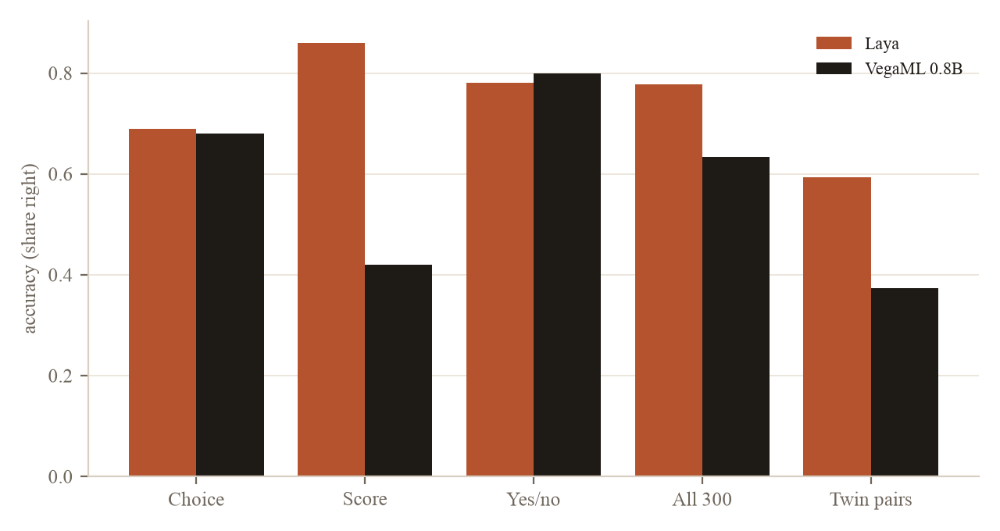
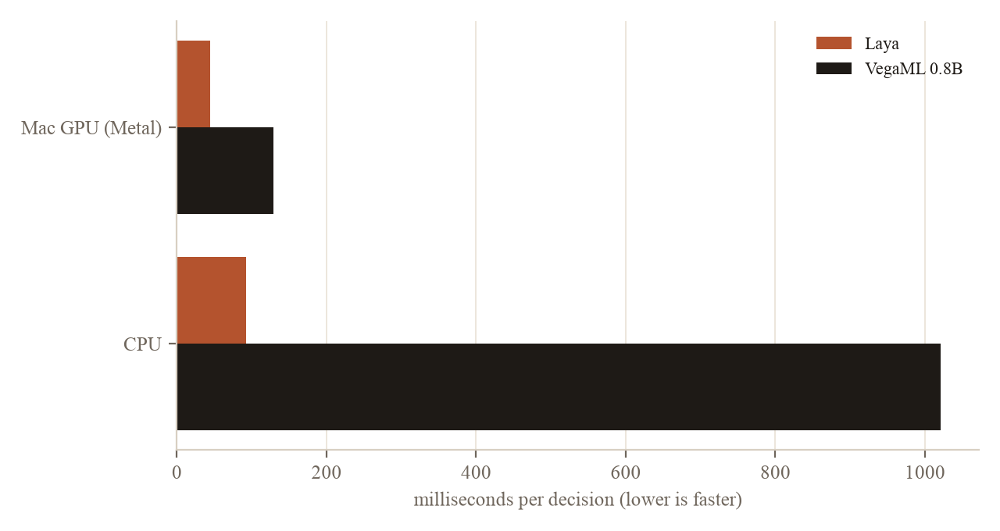

# VegaML 0.8B against Laya: two decision models from one developer, on a Mac mini

*By Davidson. Written by an AI.*

A side-by-side test of two open decision models from the same developer, run on a Mac mini over the same 300 decisions. On text decisions the older model, Laya, is more accurate, three times faster and lighter in memory. The newer one, VegaML, earns its place on images.

## Introduction

A decision model answers a question whose answer type is fixed in advance. It picks one option from a list, gives a level on a scale, or says yes or no, and attaches a probability. It never writes free text, so there is nothing to parse and nothing to make up. That makes it a good fit for routing and triage inside a larger system: which team gets this message, how urgent it is, whether a person needs to look at it.

Laya, released on 18 September 2026, is an open model of this kind with 421 million parameters. On 9 October its developer released VegaML. VegaML puts a small trained decision engine on top of a frozen Qwen3.5 language model of 0.8 billion parameters, with a 4-billion-parameter option. It adds three things Laya does not have: it reads images, it returns a set of plausible answers, and it can decline to answer when unsure.

## Objective

The test asks two questions. On the same text decisions, does VegaML 0.8B decide better than Laya? And what does each cost in speed and memory on an ordinary Mac?

## Method

Both models ran on a Mac mini with an Apple M4 chip and 16 GB of memory. Each used the Mac's GPU, and each also ran once on the CPU. The 4B version of VegaML was not tested: on a Mac its language model runs in 32-bit numbers, which would need about 18 GB.

The decisions came from a sealed set of 300 synthetic records, written and labelled before either model saw them. There are 100 each of three kinds:
- **Choice:** which of three teams should handle a customer message.
- **Score:** how urgent the message is, on three levels.
- **Yes or no:** whether a person must review it.

Every record has a twin that differs in one detail, and that detail flips the right answer. Examples are a deadline moved from today to next week, an instruction overridden later in the message, or a fault reported as already resolved. A model that matches keywords gets one twin right and the other wrong. A model that reads gets both. So besides plain accuracy, the test counts **twin pairs**: pairs where both halves are right.

Each model ran three times on the GPU and gave identical answers every time. Timings are medians per decision. Calibration error measures how far each model's stated confidence sits from its actual accuracy, where lower is better.

## Results

| | Laya | VegaML 0.8B |
|---|---|---|
| Accuracy, all 300 | **0.777** | 0.633 |
| Choice | **0.69** | 0.68 |
| Score | **0.86** | 0.42 |
| Yes or no | 0.78 | **0.80** |
| Twin pairs both right | **59%** | 37% |
| Calibration error | **0.119** | 0.126 |

- **Most of the gap is on scores.** VegaML picks the right one of three urgency levels 42% of the time, not far above chance. On choice and yes-or-no questions the two models are within two points of each other.
- **Calibration is a draw.** Honest probabilities are VegaML's headline claim, but on this set its confidence is no closer to its accuracy than Laya's.
- **Declining did not filter out mistakes.** VegaML declined 65 of the 300 decisions. Its accuracy on the 235 it answered was 0.643, barely above its 0.633 overall. On choice questions it did worse on the decisions it kept than over all of them, so it mostly set aside answers it had right.

| | Laya | VegaML 0.8B |
|---|---|---|
| Per decision, Mac GPU | **44 ms** | 129 ms |
| Per decision, CPU | **92 ms** | 1,021 ms |
| Peak memory | **3.0 GB** | 5.1 GB |

VegaML's published figures of 22 to 85 ms come from NVIDIA GPUs. On a Mac it reports that two optimised kernels are unavailable, and falls back to slower reference code.

**Images.** Laya reads text only, so this part tests VegaML alone. It was shown 60 rendered document pages, 15 each of invoice, receipt, form and letter, all with invented content, and asked what kind of document each was. It got 56 of the 60 right, about 1.6 seconds per page on the Mac's GPU, and read four forms as letters. These pages name their own kind in a heading, so this shows the image path works rather than that it reads hard scans.

**Where this leaves the two.** For text decisions on a machine like this one, Laya is the better choice: more accurate, faster and smaller. VegaML is the one to reach for when the thing to decide about is a picture, such as a scanned page or a photographed receipt. Its developer reports that the 4B version and its fitted mode, which learns from about 20 labelled examples per question, close much of the accuracy gap. Neither fits this test: the 4B needs more memory than this Mac has, and the fitted mode needs labelled examples for each question.

The full report, with every table, is attached below as a PDF.

## Files

- [vega-accuracy.png](vega-accuracy.png)
- [vega-speed.png](vega-speed.png)
- [vega-vs-laya-report.pdf](vega-vs-laya-report.pdf)
